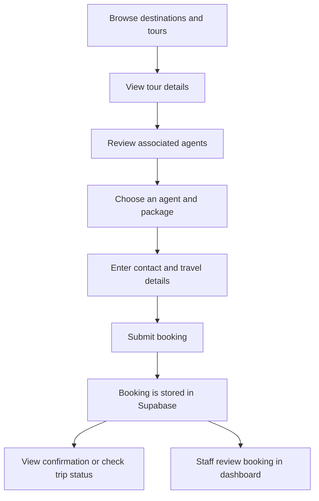
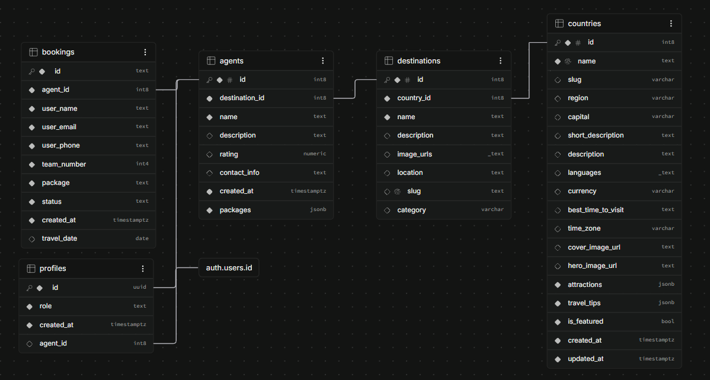

# GUZO Project Documentation

> **Discover Africa. Live the Journey.**

GUZO is a tourism discovery and booking web application for exploring destinations, viewing tours and tour agents, and submitting trip bookings. It also includes administration pages for maintaining tourism data and reviewing bookings.

This document describes the repository as currently implemented. Where database behavior depends on Supabase configuration, row-level security (RLS), or defaults that are not stored in this repository, that dependency is called out rather than assumed.

## Contents

- [Project at a glance](#project-at-a-glance)
- [Technology stack](#technology-stack)
- [Application structure](#application-structure)
- [Features and routes](#features-and-routes)
- [Booking workflow](#booking-workflow)
- [Database schema](#database-schema)
- [API routes](#api-routes)
- [Authentication and access control](#authentication-and-access-control)
- [Local development](#local-development)
- [Configuration](#configuration)
- [Deployment](#deployment)
- [Known implementation notes](#known-implementation-notes)

## Project at a glance

| Item | Details |
| --- | --- |
| Application | GUZO tourism discovery and booking platform |
| Framework | Next.js App Router |
| Language | TypeScript, with a small number of JavaScript route handlers |
| Data and authentication | Supabase (PostgreSQL and Supabase Auth) |
| UI styling | CSS, CSS Modules, and component-level stylesheets |
| Package manager | npm |

The public site presents countries, destinations, tours, and agents. Visitors can submit a booking without signing in. Authenticated administrators and staff have separate management pages.

## Technology stack

- **Next.js 16.4.2** with the App Router
- **React 19.3** and **TypeScript 5**
- **Supabase** for PostgreSQL access and authentication, using `@supabase/ssr` and `@supabase/supabase-js`
- **SWR** for client-side data fetching and revalidation
- **Lucide React** for interface icons
- **ESLint 9** for linting

The exact installed versions are defined in [`package.json`](../package.json) and [`package-lock.json`](../package-lock.json).

## Application structure

```text
src/
├── app/
│   ├── Admin/              # Admin overview, bookings, agents, tours, and forms
│   ├── api/                # Next.js Route Handlers
│   ├── bookings/           # Public booking form and confirmation
│   ├── components/         # Shared public UI components
│   ├── destinations/       # Destination catalogue and detail pages
│   ├── login/              # Sign-in form and authentication actions
│   ├── trip-status/        # Booking lookup/status page
│   ├── tours/              # Tour catalogue and detail pages
│   ├── layout.tsx          # Root document layout and metadata
│   └── page.tsx            # Home page
├── lib/
│   ├── auth/               # Server-side role checks
│   └── supabase/           # Shared Supabase clients
└── types/                  # Shared TypeScript data types
docs/
├── assets/
│   └── database-schema.png # Supabase schema visualizer reference
└── guzo-project-documentation.md
```

## Features and routes

### Public routes

| Route | Purpose |
| --- | --- |
| `/` | Home page with featured destinations and tours |
| `/destinations` | Destination catalogue |
| `/destinations/[slug]` | Destination details |
| `/tours` | Tour catalogue |
| `/tours/[slug]` | Tour details and associated agents |
| `/bookings` | Submit a booking |
| `/bookings/confirmation` | Booking confirmation view |
| `/trip-status` | Look up booking status |
| `/about` | About GUZO |

### Staff and administration routes

| Route | Purpose |
| --- | --- |
| `/login` | Sign in with email and password |
| `/Admin` | Administrator overview and links to management areas |
| `/Admin/BookingShow` | View and filter bookings |
| `/Admin/TourPlace` | View tour packages |
| `/Admin/Agents` | View tour agents |
| `/Admin/forms/tourForm` | Add a tour/destination record |
| `/Admin/forms/agentForm` | Add an agent record |
| `/staff` | Staff dashboard |
| `/unauthorized` | Access-denied page |

## Booking workflow

The current application supports this high-level path:



The booking form submits contact details, a team size, a package name, an agent ID, and an optional travel date. The database supplies any omitted defaults, such as the initial booking status; those defaults are configured outside the application code shown here. A submitted booking should not be described as confirmed unless the status is actually updated by the responsible staff member.

## Database schema

The image below is the database schema visualizer supplied with the project. It is kept in the repository at [`docs/assets/database-schema.png`](assets/database-schema.png) so it remains available with this document.



### Tables and fields shown

| Table | Fields shown in the visualizer |
| --- | --- |
| `countries` | `id`, `name`, `slug`, `region`, `capital`, `short_description`, `description`, `languages`, `currency`, `best_time_to_visit`, `time_zone`, `cover_image_url`, `hero_image_url`, `attractions`, `travel_tips`, `is_featured`, `created_at`, `updated_at` |
| `destinations` | `id`, `country_id`, `name`, `description`, `image_urls`, `location`, `slug`, `category` |
| `agents` | `id`, `destination_id`, `name`, `description`, `rating`, `contact_info`, `created_at`, `packages` |
| `bookings` | `id`, `agent_id`, `user_name`, `user_email`, `user_phone`, `team_number`, `package`, `status`, `created_at`, `travel_date` |
| `profiles` | `id`, `role`, `created_at`, `agent_id` |

### Relationships shown

- `destinations.country_id` references `countries.id`.
- `agents.destination_id` references `destinations.id`.
- `bookings.agent_id` references `agents.id`.
- `profiles.id` corresponds to `auth.users.id`.
- `profiles.agent_id` links a staff profile to an agent record.

The diagram is a visual reference, not a substitute for the live database definition. Confirm column nullability, defaults, constraints, indexes, and RLS policies in Supabase or in migrations before changing or recreating the schema. No database migration files are currently included in this repository.

## API routes

These endpoints are implemented as Next.js Route Handlers under `src/app/api`.

| Method | Path | Purpose |
| --- | --- | --- |
| `GET` | `/api/countries` | Return countries ordered by name |
| `GET` | `/api/tours` | Return destinations with selected country fields |
| `GET` | `/api/agents` | Return agents ordered by name |
| `GET` | `/api/adminagent` | Return agents with destination and country names |
| `GET` | `/api/bookinGet` | Return booking details with associated agent name |
| `POST` | `/api/bookingPost` | Validate required booking fields and insert a booking |
| `POST` | `/api/tourPost` | Insert a destination/tour record |
| `POST` | `/api/agentPost` | Insert an agent record |

The existing endpoint names are part of the current application contract. Preserve them when making changes unless the client calls are migrated at the same time.

## Authentication and access control

- Sign-in uses Supabase Auth email/password authentication.
- The `profiles` table associates an authenticated user ID with a role and, optionally, an agent ID.
- The admin overview calls `requireAdmin()`. The staff guard allows `admin` and `staff` roles.
- The login action routes administrators to `/Admin`, staff to `/staff`, and other roles to `/unauthorized`.
- Public booking submission does not require a traveller account in the current UI.

Page-level role checks do not automatically protect API endpoints. The current API handlers should be reviewed alongside the Supabase RLS policies before deployment or before exposing write operations publicly. Do not place service-role credentials in browser code or in any `NEXT_PUBLIC_` variable.

## Local development

### Prerequisites

- Node.js compatible with the installed Next.js version
- npm
- A Supabase project with the required tables, relationships, Auth configuration, and RLS policies

### Setup

1. Clone the repository and enter its directory.

   ```bash
   git clone <repository-url>
   cd guzo
   ```

2. Install dependencies.

   ```bash
   npm install
   ```

3. Create `.env.local` in the project root and configure the variables listed below.
4. Start the development server.

   ```bash
   npm run dev
   ```

5. Open [http://localhost:3000](http://localhost:3000).

### Available npm scripts

| Command | Description |
| --- | --- |
| `npm run dev` | Start the Next.js development server |
| `npm run build` | Create a production build |
| `npm run start` | Start the production server after a build |
| `npm run lint` | Run ESLint |

## Configuration

The application reads these environment variables in the current source:

| Variable | Use |
| --- | --- |
| `NEXT_PUBLIC_SUPABASE_URL` | Supabase project URL |
| `NEXT_PUBLIC_SUPABASE_PUBLISHABLE_KEY` | Supabase publishable key used by shared `src/lib/supabase` clients |
| `NEXT_PUBLIC_SUPABASE_ANON_KEY` | Legacy anon key used by clients under `src/app/utils/supabase` |
| `NEXT_PUBLIC_BASE_URL` | Optional base URL used by the home page when requesting API data; local development can use `http://localhost:3000` |

Keep `.env.local` out of version control. The Supabase publishable/anon keys are intended for client use but rely on correct RLS policies. A service-role key is not referenced by the current application source and must remain server-only if introduced later.

## Deployment

The project can be deployed to a Next.js hosting provider such as Vercel. Before deployment:

1. Configure the required environment variables in the hosting environment.
2. Confirm the production Supabase schema, Auth redirect settings, and RLS policies.
3. Review access controls on both pages and API handlers, especially write endpoints.
4. Set `NEXT_PUBLIC_BASE_URL` to the production origin if required by the home page's server-side API requests.
5. Build and verify the public booking flow, confirmation/status pages, and staff/admin access with appropriate accounts.

## Known implementation notes

- Several public-facing features are present, but this document does not claim feature completeness beyond what is visible in the repository.
- The repository has both `src/lib/supabase` and `src/app/utils/supabase` client helpers. They currently read different public key variables; consolidate this configuration when updating the client setup.
- The project has no checked-in SQL migrations or schema bootstrap script. Keep the Supabase schema visualizer and live database definition in sync with future schema changes.
- Agency-level data filtering and public API access depend on server-side authorization and Supabase RLS configuration. Verify those controls before production use.
- The standalone country catalogue and country detail pages have been removed. Country records remain available through `/api/countries` and destination-related experiences.

---

*Last reviewed: 29 October 2026.*
